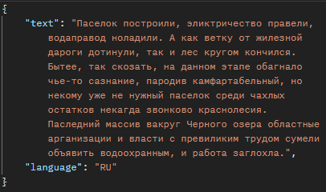
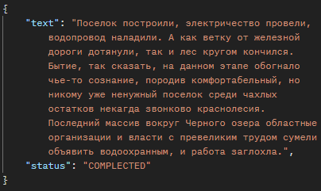

## **Error-free-text**
В этом репозитории содержится исходный код веб-приложения автоматической корректировки текста. Приложение получает от пользователя запрос с текстом для исправления орфографии, в ответ отдаёт текст с исправленными опечатками.
### **Пример работы приложения:**
| **Исходный текст** | **Исправленный текст** |
|--------------------|------------------------|
|            |                  |
### Стек технологий:
1. **Java 17**
2. **Spring Boot 3.5.16**
3. **СУБД: PostgreSQL 17**
4. **Система сборки: Gradle 9.8.0**
5. **Контейнеризация: Docker**
6. **Система управления миграциями БД: Liquibase**
7. **Lombok**
8. **Тестирование:**
   - **Unit-тесты: JUnit5, Mockito, MockWebServer**
   - **Интеграционное тестирование: Testcontainers**

**Обратите внимание:** Из-за особенностей сборки приложения в **docker-контейнере** интеграционное тестирование нужно запускать отдельно.
### Запуск
1. Для запуска приложения необходимо установить **Docker** и **Git**. После установки клонируйте репозиторий с помощью выполнения команды в терминале:
   ```
   git clone https://github.com/Amigos489/error-free-text.git [директория для сохранения]
   ```
2. Затем, находясь в директории проекта, выполните команду для сборки **docker-образа**:
   ```
   docker build -t error-free-text
   ```
3. После завершения сборки запустите приложение командой:
   ```
   docker compose up -d
   ```
Для работы с приложением можно воспользоваться инструментом для тестирования **API** **Postman**:

**https://www.postman.com**. 

Приложение доступно по адресу: 

**http://localhost:8080/error-free-task/api**

Для проверки орфографии в тексте приложение использует **API** сервиса **Яндекс Спеллер**:

**https://yandex.ru/dev/speller**

Перед отправкой запроса приложение проверяет текст на содержание цифр и **URL**-адресов. Если слово содержит **URL**-адрес или цифры, то при проверке оно будет проигнорировано. Неверное употребление ПРОПИСНЫХ/строчных букв в словах за ошибку не считается. Подробнее о настройках в документации **Яндекс Спеллера**:

**https://yandex.ru/dev/speller/doc/ru/reference/speller-options**

### **Документация API**

#### 1. **Создание новой задачи**
```
POST /tasks
```
   **Требование к телу запроса:**
   - корректный параметр Языка (EN или RU),
   - текст должен содержать минимум 3 символа,
   - текст не может содержать только спецсимволы и цифры.
   
#### 2. **Получение задачи по id**
```
GET /tasks/{id}
```
   **В зависимости от статуса задачи могут возвращаться следующие форматы ответов:**
   - **Если задача уже завершена** - пользователю возвращается ответ, содержащий статус и скорректированный текст.
   - **Если задача находится ещё в процессе** - ответ содержит только статус.
   - **Если при выполнении задачи произошла ошибка** - возвращается статус и описание ошибки.
